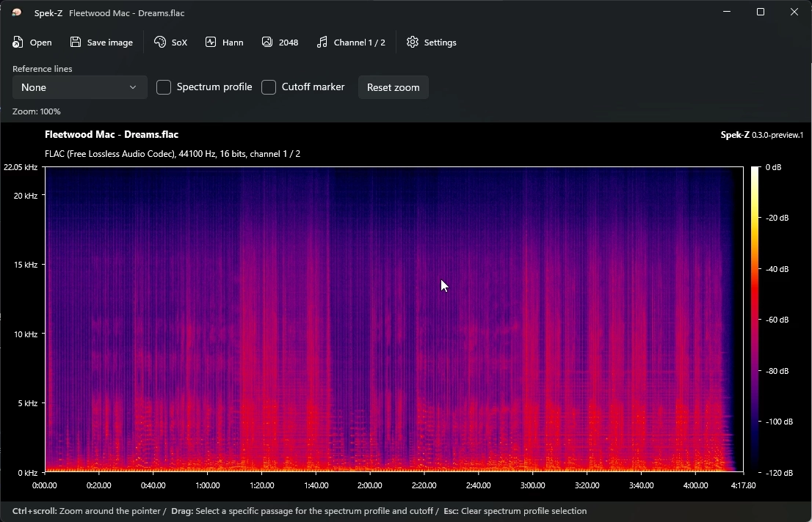

# Spek-Z

A WinUI 3 audio spectrogram analyzer for Windows, with interactive zoom and reusable .NET libraries.

See an audio file's frequency content over time, inspect spectral detail, and export the view as a PNG.

## Features

- Zoom in time and frequency, with background analysis for more detail.
- Inspect time, frequency and spectral level under the pointer.
- View an average spectrum for the whole track or a selected passage.
- Choose the palette, FFT size, window function, audio channel and stream.
- Export spectrograms as PNGs, including from the command line.
- Display optional cutoff markers and LAME low-pass reference lines.

Cutoff markers describe spectral drops. They do not prove a file's original codec, bitrate or lossless authenticity.

## App

Spek-Z currently builds from source for Windows x64 and ARM64. There is no standalone app download or Microsoft Store listing yet.

See the [app guide](https://github.com/DerekYang2/spek-z/wiki/Using-the-app) and [build instructions](https://github.com/DerekYang2/spek-z/wiki/Building-and-releasing).

## Libraries

Use the analysis engine without a UI, or embed the spectrogram in your own WinUI 3 app.

| Package | Purpose |
| --- | --- |
| [Spek.NET](https://www.nuget.org/packages/Spek.NET) | Audio decoding through FFmpeg, FFT analysis, spectrogram data and palettes. Targets .NET 10 with no UI dependency. |
| [Spek.NET.WinUI](https://www.nuget.org/packages/Spek.NET.WinUI) | A Win2D-rendered `SpekView` control with zoom, inspection and PNG export. |

Both packages are GPL-3.0-only. They do not include FFmpeg; your application supplies it. Stable examples and installation instructions are in the [library guide](https://github.com/DerekYang2/spek-z/wiki/Using-the-libraries).

## Documentation

The [wiki](https://github.com/DerekYang2/spek-z/wiki) has the controls, FFT guidance, library examples and development instructions.

## Credits and license

Based on [Spek](https://github.com/alexkay/spek) and [spek-X](https://github.com/MikeWang000000/spek-X). The icon adapts Spek's artwork by Olga Vasylevska.

Licensed under [GPL-3.0](LICENSE).
